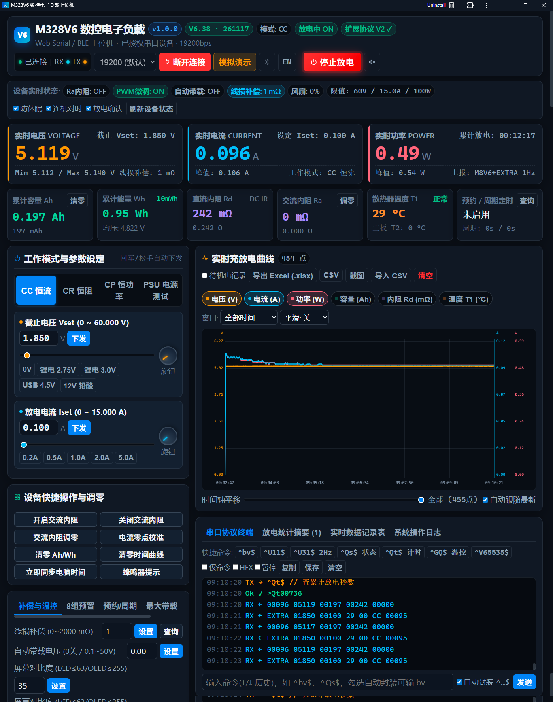

# M328V6 上位机套件（PC 桌面 / Web / Android 移动端）  

M328V6 数控电子负载的全平台上位机软件   

用于取代 [老的上位机](https://github.com/cdhigh/m328v6host)   





## 目录结构

```text
tools/m328v6_android_host/
├── pc/                         # PC 桌面端（支持 Windows / Linux / macOS）
│   ├── m328v6_web_host.html    # 主界面与通信核心（Web Serial / Web BLE）
│   ├── start_pwa_server.bat    # Windows PWA 本地应用一键启动器
│   ├── start_pwa_server.sh     # Linux / macOS PWA 本地应用启动脚本
│   ├── manifest.webmanifest    # 桌面独立应用配置
│   ├── sw.js                   # Service Worker 离线缓存
│   ├── icon-192.png            # 图标
│   ├── icon-512.png
│   └── README.md               # 上位机使用指南
│
└── android/                    # Android 手机 / 平板 原生应用工程
    ├── app/                    # Android 模块源码（原生蓝牙/OTG桥接）
    ├── gradlew.bat             # Gradle 自动化构建脚本
    ├── build.gradle.kts        # 自动同步 ../pc/m328v6_web_host.html 到 assets
    ├── ic_launcher_512.png     # Android 512x512 高分图标
    └── README.md               # Android 编译与使用指南
```

## 快速入口
- **PC 用户**：
1. 直接进入 `pc` 目录，双击打开 `m328v6_web_host.html` 
2. 安装Python后运行 `pc/start_pwa_server.bat`，打开chrome后，可以点击chrome右上角的Install，将会将上位机安装为chrome app，以后就可以使用桌面快捷方式直接打开。
- **Android 用户 / 开发者**：安装 [Release](https://github.com/cdhigh/m328v6webhost/releases) 的android版本，或直接使用 Android Studio 打开 `android/`目录即可编译生成 APK。
